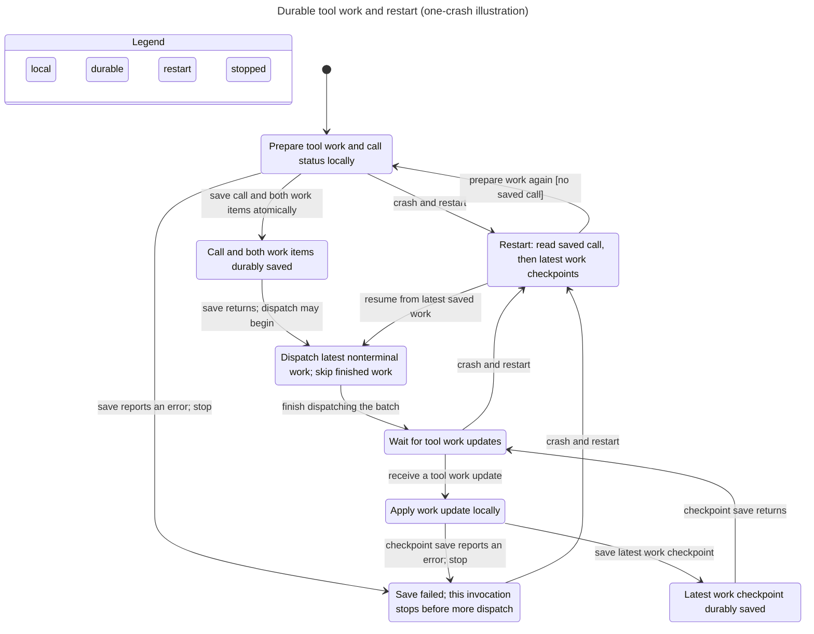

# Statechart reading of the verification results

The upstream pstack `/statechart` skill was actually run on all four
configurations. It rechecked remaining rules after each expected violation:

| Config | Result | Full exploration states |
| --- | --- | ---: |
| fixed (two crashes) | TypeOK, CommitBeforeAdd, NoTerminalOrStaleAdd hold | 510 |
| skip-status-commit | Both safety rules fail; TypeOK holds | 452 |
| skip-terminal-guard | NoTerminalOrStaleAdd fails; other rules hold | 566 |
| skip-latest-overlay | NoTerminalOrStaleAdd fails; other rules hold | 846 |

These counts include exploration after violations, unlike the first-failure
counts from the normal verification command. All violations here are deliberate
broken variants, **not findings in current product code**. The real-source
mutation self-test independently caught the corresponding regressions.

The unmodified statechart tool used its own pinned release artifact (v1.7.4,
reporting TLC 2.19 / 08 August 2024, rev 5a47802), SHA-256
`936a262061c914694dfd669a543be24573c45d5aa0ff20a8b96b23d01e050e88`.
Its SANY parser did not support the newer TLC artifact pinned by this project's
normal verification runner. The tools agreed on the fixed state count and
shortest paths. See README for the compatibility explanation.

## Passing flow illustration

The two-crash model exceeds the statechart tool's 500-state full-chart budget.
For this illustration only, MaxCrashes was reduced to **one**: 298 states,
420 model steps, all three invariants hold. The chart draws eight states and
13 arrows. It hides 36 repetitive reset transitions and merges 92 within-label
steps. This chart does not replace the two-crash verification. Cosmetic title
normalization is the only edit to the emitted Mermaid below.

## Expected shortest counterexamples, in the code's terms

1. **Skipped commit: CommitBeforeAdd and NoTerminalOrStaleAdd.** A tool may
   reach the manager only after its status and operation snapshots are saved.
   Statechart path 0–8: start with a saved model response (0), translate two
   Ready operations (1), install each locally (2–3), apply local status (4),
   skip saving status/operations (5), return as if saved (6), pass dispatch
   guard (7), call Add without any canonical initialization (8).
2. **Missing terminal guard: NoTerminalOrStaleAdd.** A finished durable
   operation must not be sent to the manager again. Path 0–22: prepare and
   commit the pair, then Add both (0–11); receive Terminal (12), save its
   checkpoint (13), crash before save returns (14), replay original Ready
   snapshots and saved call (15–17), overlay latest Terminal (18–19), resume
   dispatch (20), omit terminal filtering (21), Add the terminal operation (22).
3. **Missing latest overlay: NoTerminalOrStaleAdd.** A recovered operation
   must use its latest saved checkpoint, not the initial tool snapshot. Path
   0–22: same preparation/commit/dispatch (0–11); receive Awaiting (12), save
   it (13), crash (14), replay initial Ready and saved call (15–17), ignore
   latest checkpoints (18–19), resume dispatch (20), allow Ready (21), Add
   stale Ready instead of canonical Awaiting (22).

The underlying full tool reports and charts from this run are under
`/tmp/coordinator-dispatch-statechart/` (ephemeral). Use `/statechart`'s current
instructions on the checked-in model/configs to regenerate; release-specific
commands and installed paths intentionally are not copied into this record.

The model leaves out final result reconciliation, payload equivalence,
filesystem durability, arbitrary workloads, manager effects, and liveness.
See SKILL.md and README for the full bounds and real-Go coverage.
